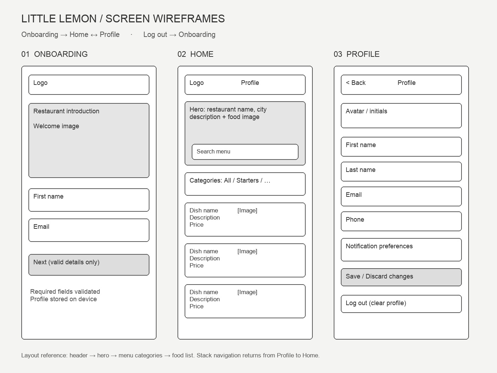

# Little Lemon — React Native Capstone

A runnable Expo / React Native application for the Meta React App Capstone. It implements onboarding, a searchable restaurant menu, category filters and a persistent profile, with React Navigation native stack screens.



## Run

Use Node.js 22 LTS (22.13 or later) and npm.

```sh
npm ci
npm start
```

Open the project with an Expo Go version compatible with Expo SDK 58, or use a compatible iOS/Android development build. Press `i` for an installed iOS simulator or `a` for an installed Android emulator. To review the same React Native components in a browser:

```sh
npm run web
```

No backend, credentials, API keys or environment variables are required. The menu and photos are bundled, so the app works offline after loading. Demo names and emails can be used: onboarding stores data locally, and does not create an authenticated account.

## Review checklist

1. On a fresh install, Onboarding appears. Next is disabled until a nonempty first name and valid email are entered.
2. Enter `Demo` and `demo@example.com`, then Next. Home has the header, restaurant hero and search field, category buttons and menu list.
3. Select Desserts; only desserts remain and the selected category is highlighted. Search `lemon`. Search and category filters work together. Select All or clear filters to reset.
4. Open the initials button. Profile contains the details from onboarding. Use the native stack Back button to return to Home.
5. Change the last name or notification preferences and save. Restart/reload the app and open Profile again: saved values remain. Discard changes restores the last saved values.
6. Log out. Onboarding returns with empty fields, and restarting keeps that state. Only this app's profile key is removed, not unrelated device storage.

## Project map

- `App.js`: Onboarding, Home and Profile screens; stack navigation; accessible form fields and category controls.
- `src/model.mjs`: validation, filtering and persistence helpers.
- `src/menu.js` and `assets/food/`: offline menu and photos adapted from the course's [Meta menu data](https://github.com/Meta-Mobile-Developer-PC/Working-With-Data-API).
- `design/wireframe.jpg`: three-screen layout wireframe, drawn programmatically for this project (not a Figma export).
- `tests/model.test.mjs`: validation, combined filtering, profile persistence, logout scope and storage-failure checks.

## Validation

```sh
npm test
npx expo export --platform web
```

Six automated model tests pass. Web export passes. Browser checks cover disabled onboarding, successful onboarding, combined search/categories, profile population, save/reload, Back and logout/reload. Native iOS/Android runtime testing has not been performed; native screens use Expo-compatible dependencies.

## Scope

This is a menu browsing and profile capstone, not a live ordering/payment service. It does not send emails or process orders. Profile preferences are stored on the device. AI assistance was used to implement and verify the project. Photos/menu source: the Meta course repository linked above; retained for this educational exercise.
